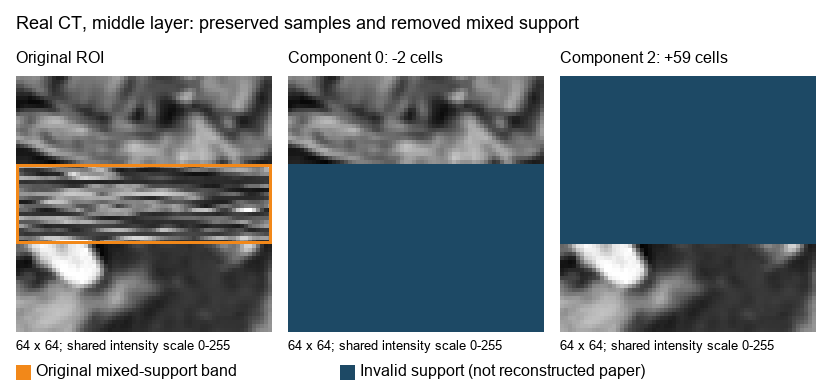

# Vesuvius workflow improvements — November follow-up

These three changes address surface flattening and CT rendering. This follow-up adds an option to separate disconnected pieces while preserving the sampling grid, more tests of Zarr restart behavior, and a standard build that exercises all three changes together. [Original November snapshot](https://github.com/higgs1729/vesuvius-workflow-improvements/tree/a35e2d49124758bc28e7fcf499bd656387e74f5c/2026-11)

| Improvement | What it does |
| --- | --- |
| R005 · Surface packing | The new opt-in --pack-components-preserve-grid mode moves disconnected pieces by whole grid cells after snapping. |
| R007 · Crop validation | The renderer rejects incomplete manual crop arguments before opening the volume. |
| R009 · Zarr output recovery | Single-part resume initializes missing pyramid arrays from the stored level-0 layout. Pyramid-disabled output lists level 0 in its OME metadata. |

Standard CMake/Ninja built four native targets at the fixed upstream revision. Integrated tests covered one packed surface, the crop CLI suite, and a small two-chunk CT render with two resume cases. Separate experiments cover sampling and actual interruptions. [Reproduce](REPRODUCE.md) · [Evidence and scope](EVIDENCE.md) · [Data](DATA.md)

Blue denotes invalid interpolation support in this comparison generated from saved CT outputs. All 14,080 samples with pure component support matched across five depth offsets. The original 1,280 mixed-support positions became invalid in both translated crops. The physical correspondence of the second piece and any effect on legibility remain unresolved. [Detailed conditions](EVIDENCE.md)

[Source hashes](SOURCE_HASHES.json) · [Result extracts](RESULTS.json) · [File manifest](MANIFEST.json) · [Licenses](LICENSE_SCOPE.md)
