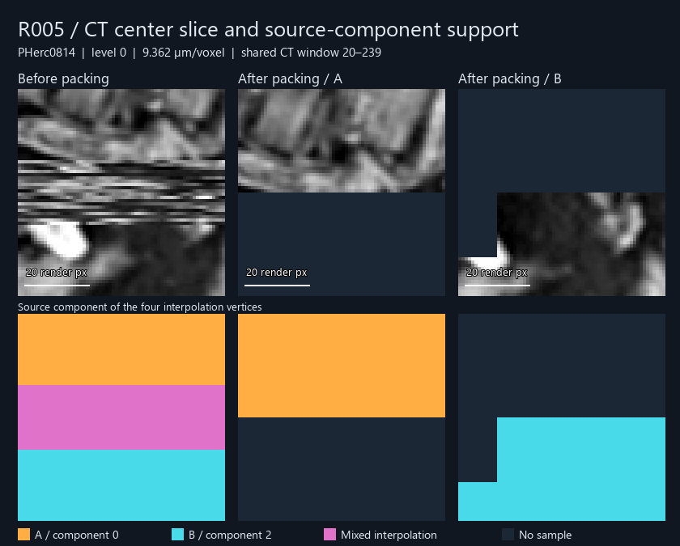

# Small improvements to the Vesuvius surface-rendering workflow

This is a November 2026 contribution bundle for Volume Cartographer and vc_reader: keep disconnected surface pieces separate, reject incomplete crop requests early, and recover missing Zarr pyramid levels. The three changes share the goal of making existing rendering work more predictable. They are intended for one combined Progress Prizes submission.

This local candidate was prepared with AI agents. An agent other than the implementer independently checked the native product results and the targeted Python entry. Public release, submission, upstream acceptance, human review and external adoption are not claimed.

| Contribution | Observed result | What remains outside the claim |
|---|---|---|
| [Separate disconnected flatboi components](component-packing/README.md) | Cross-component raster rejections fell from 189/399 to zero on two public meshes. Output grid edges joining different components fell from 106/284 to zero. | Within-component overlaps, correctness of segmentation, fiber preservation and text readability. The output can become wider. |
| [Reject incomplete manual crops](crop-guard/README.md) | A missing height that selected a 13,600 × 3,440 canvas instead of 128 × 128 now fails before input loading. Valid selection and three TIFF controls were preserved. | The full canvas was not rendered. Time, download and monetary savings were not measured. |
| [Recover Zarr outputs and write correct level references](zarr-output-recovery/README.md) | First-use and partial-output resume succeed; six tested cases match all 14 normal-control files. Mixed-format partial output is preserved while missing levels are created. Pyramid-disabled OME lists only level 0. | Every dtype/codec, Zarr v3, forced process termination, concurrent multi-part use and downstream viewer behavior. |

## Example: disconnected pieces

One edge was selected from geometry before examining the scan. Before packing, 1,280 pixels in a small crop interpolated between two disconnected pieces whose edge endpoints were about 304 scan voxels apart. Afterwards the tracked faces were rendered in two separate crops with zero mixed pixels. The crops have different valid areas and raster phases; this is not a pixelwise aligned 3D comparison. The second piece's correspondence to one correct papyrus sheet remains unresolved.

## Use and reproduce

Each item contains its product patches, exact source references, checks or measurements, verification scope and license notices. Start with the linked item README. Apply only the product patches to use the changes; diagnostic patches in the component-packing item are optional measurement instrumentation.

The current patch target for the renderer and Python changes is villa commit `0080fa393724575d4f19059d91402757f9351b28`. Its flatboi source has the same Git blob `2dcf5981008e6b68b8c29ef7e083fc769f40e163` as the earlier component-packing experiment. The individual item records retain their original tested revisions.

The crop and Zarr patches were also checked together in one renderer: normal output and first-use resume matched the original 14-file control, and all 18 crop CLI checks passed. Partial-state recovery was independently checked in the shared resume implementation before the metadata and crop patches were combined. The components patch changes the separate flatboi program.

Native builds used an existing configured Ubuntu 24.04/GCC 13 environment and reused dependencies. A fresh full-repository installation was not tested. The experiments used local CPU computation, not paid cloud or GPU computation. Local electricity and model usage costs were not calculated.

The Zarr item's real Python wrapper and native extensions also passed an isolated runtime check and independent replay. Its tiny-array check is reusable without CT data; it supplements the real-CT product results. Normal package initialization, a wheel and the pytest runner were not validated.

## Reuse and attribution

Newly authored additions and original explanatory material are offered under MIT as stated in the per-item notices. Modified Volume Cartographer remains under GPLv3; upstream vc_reader/villa and dependencies retain their licenses. Dataset-derived figures and measurements retain their source terms; see [data attribution](component-packing/DATA_SOURCES.md). No raw CT, source meshes, third-party build packages or compiled executables are included.

The tests document the product contributions; they are not presented as a separate collection of evaluation tools. The root `MANIFEST.json` records all packaged file hashes, while the item manifests preserve the identities of the reviewed candidates.
