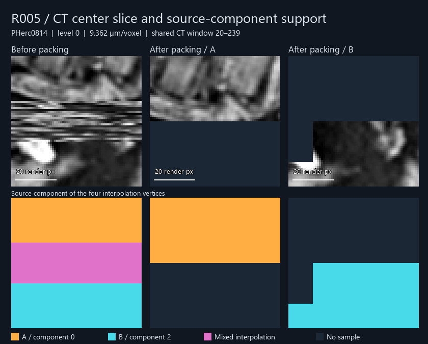

# Optional component packing for flatboi

An opt-in layout step prevents disconnected surface pieces from sharing raster samples or being joined by neighboring output grid points. It preserves source XYZ and faces and runs after the existing SLIM calculation. The option defaults to off.

The [product patch and complete build/run instructions](flatboi/README.md) are the main contribution. The separate observation patches and evaluator document its effect; they are not a standalone tool submission. Changes were prepared on 12 November 2026 using AI agents. A different AI agent independently checked the saved experiments. Human use, human code review and upstream adoption are not claimed.

| Full-resolution public PHerc0814 input | Cross-component raster rejections | Output edges between components |
|---|---:|---:|
| `20250929040153-auto_grown_20250929040153260` | 189 → 0 | 106 → 0 |
| `20250928235953-auto_grown_20250928235953722` | 399 → 0 | 284 → 0 |

Both used five SLIM iterations. The output becomes wider. One and 356 observed within-component rejection pairs remain, respectively. See [results](flatboi/results.json) and [verification scope](flatboi/VERIFICATION.md).

A single edge was selected using geometry before downloading CT. Its two endpoints are about 304 scan voxels apart. Before packing, 1,280 of the 64×64 pixels interpolate between the two components. After packing, the same original faces are tracked in separate crops, each with zero mixed pixels. The horizontal streaks in the before image coincide with the mixed band. The crops are not pixelwise matches in 3D; their valid areas and grid phases differ.

The CT experiment used the existing surface and volume interpolation code, ten public CT chunks totaling 20 MiB, and no GPU or paid cloud computation. All 39,760 valid samples and the masks/rounding of 15 TIFFs were independently checked. [CT setup, measurements and limits](ct/README.md).

This does not establish fiber preservation or ink readability. The second component in this local comparison does not match the published processed mesh closely; whether it lies on one correct papyrus sheet remains unresolved. This option separates components supplied by the input. It does not repair their segmentation or within-component overlaps.

[Data attribution](DATA_SOURCES.md) · [License scope](LICENSE_SCOPE.md) · [Provenance](PROVENANCE.json)
