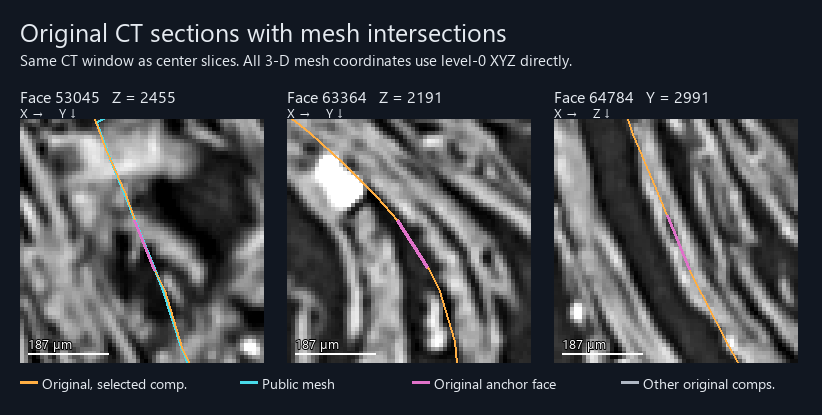

# One local CT comparison

The images show one fixed edge, selected before viewing CT using source geometry and download size. The rule, original face/vertex IDs and the three crops are in [crops.json](crops.json). Both after crops track the same original faces as the before crop. They do not represent a pixelwise aligned comparison. All crops are 64×64 at scale 1, level 0 of the 9.362 µm PHerc0814 volume, with linear surface and trilinear CT interpolation. The displayed center layer has zero normal offset; five stored layers use offsets −2, −1, 0, +1 and +2 voxels. Normal directions vary with each crop.

| Crop | Valid pixels per layer | Mixed-component pixels |
|---|---:|---:|
| Before | 4,096 | 1,280 |
| After, component 0 | 2,048 | 0 |
| After, component 2 | 1,808 | 0 |



Three non-collinear patches of source component 0 match the published processed mesh within 0.005–0.464 voxel, supporting the common level-0 XYZ coordinates without translation. The two checked patches of component 2 are 24.69–52.91 voxels from that published surface. The initial correspondence gate failed for component 2. The same candidate and CT coordinates were retained for a diagnostic comparison, with that uncertainty explicitly preserved. No `z_crop_start=822` correction was applied. The section figure does not establish that component 2 follows one correct sheet.

The fixed download plan is in [frozen-selection.json](frozen-selection.json); its local experiment paths have been omitted in this portable copy. [chunks.json](chunks.json) lists ten 128³ uint8, uncompressed C-order ZYX chunks, totaling 20 MiB. The original volume metadata and coordinates must be retained when building a local cache. The trial checked all required neighboring voxels before running without network access, so an unrequested chunk could not silently stand in for valid data.

With the before/after tifxyz outputs generated by [the product instructions](../flatboi/README.md), the corresponding existing `vc_render_tifxyz` settings are:

```bash
# Use the same tested villa source revision and a configured native build.
RENDERER=/absolute/path/to/vc_render_tifxyz
VOLUME=/absolute/path/to/the/local/ct-volume.zarr
SURFACE=/absolute/path/to/before/output
OUTPUT=/absolute/path/to/a/new/render-directory

"$RENDERER" --volume "$VOLUME" --segmentation "$SURFACE" \
  --tif-output "$OUTPUT" --scale 1 --group-idx 0 \
  --num-slices 5 --slice-step 1 --surface-interpolation linear \
  --voxel-size 9.362 --voxel-unit micrometer --cache-gb 1 \
  --crop-x 7428 --crop-y 2378 --crop-width 64 --crop-height 64
```

For after/component 0, use the packed surface and crop `(7388,2368,64,64)`; for after/component 2 use `(8588,608,64,64)`. Each output directory must be different. The recorded trial used a separate observation build of this existing renderer, pinned to one CPU/thread with a 4 GiB address-space limit and a 120-second limit per render. A common display window of 20–239 was used for the center/section images. The center-image scale bar is a nominal render-pixel width, not a claim of uniform physical distance across the distorted before band.

A different AI agent independently reconstructed selection, source-face tracking, interpolation support, CT neighbors, values, TIFF masks/rounding and the three CT sections. For all 39,760 valid samples, independently computed trilinear values differed from saved native values by at most 0.0000382 intensity units. All 15 TIFFs matched the native rounding and masks exactly. Directly rounding the independent float64 values changes one near-half-integer pixel in the before −2 layer; it does not affect the center image or the component-support counts. [Measurements](measurements.json).

This review package contains the figures and small measurement records. Full native outputs, source observations, input objects, independent-check code and failed attempts remain frozen in the original research record, identified by [provenance hashes](../PROVENANCE.json). The shell example documents the recorded settings; it has not been rerun as a separate fresh-environment reproduction. No fiber or ink-readability improvement is claimed.
