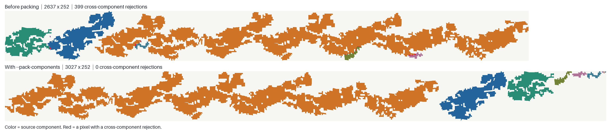

# Optional component packing for flatboi

`--pack-components` places disconnected surface pieces in separate horizontal intervals before the existing rasterizer runs. It addresses samples from one piece overwriting samples from another. The option is off by default. It changes the output layout and can increase its width; overlaps within a piece remain possible.



The colors identify source components. Red marks pixels with a rejection between different components. The figure shows measured ownership, not CT intensity or detected ink.

The product change is [one patch](pack-components.patch) to `volume-cartographer/libs/flatboi/flatboi.cpp`. It uses the existing libigl component finder, preserves XYZ and face connectivity, and translates each component's UVs before rounding back to float32. Pieces with eligible finite faces are ordered by their original vertex count. The nominal gap is two source cells. If at most one component has eligible faces, the UVs are unchanged.

Two public PHerc0814 inputs were tested at full resolution with five SLIM iterations:

| Measurement | First, before → after | Second, before → after |
|---|---:|---:|
| Rejections between different components | 189 → 0 | 399 → 0 |
| Adjacent valid grid points from different components | 106 → 0 | 284 → 0 |
| Input quad centres farther than 20 voxels from a same-component sample | 167 → 0 | 485 → 202 |
| All raster rejection events | 190 → 1 | 757 → 356 |
| Output width × height | 553×172 → 680×172 | 2637×252 → 3027×252 |

The remaining 1 and 356 observed rejection pairs overlap inside the same component. The distance threshold is a sampling measure, not a measure of legibility or lost area. Using the original grid directly gives 49 and 11 centres above that threshold, respectively. Packing is therefore not an overall replacement for every existing parameterization.

The tests used Ubuntu 24.04 under WSL, GCC 13 and an existing `-O0` build, one CPU and one numeric thread. The second input's new native run took 115.50 seconds and at most 1,029,111,808 bytes of child RSS. These single runs are not a speed benchmark. A separate AI agent reviewed the change and independently checked the saved data. No human use, human code review, upstream acceptance, ink readability or prize award is claimed. See [verification and provenance](VERIFICATION.md) and [machine-readable results](results.json).

The tested source base is `7ad02f4f6e306b744ef6d2742dfe31fd55713ee5`. Its flatboi file blob, `2dcf5981008e6b68b8c29ef7e083fc769f40e163`, was also present in inspected main `f0e441016900cb946bc3861025eca3a7cc2aae19`. The earlier initial-UV stride diagnosis belongs to [alpaltian's issue #2500](https://github.com/ScrollPrize/villa/issues/2500); that change is not included here.

Use a Linux/WSL villa source checkout and an already configured CMake build that can build `flatboi`. For a new environment, follow [the upstream source build instructions](https://github.com/ScrollPrize/villa/blob/7ad02f4f6e306b744ef6d2742dfe31fd55713ee5/volume-cartographer/README.md). A prebuilt installed binary will not include a source patch.

```bash
KIT=/absolute/path/to/flatboi-pack-components-20261112
VILLA_SOURCE=/absolute/path/to/villa
VILLA_BUILD=/absolute/path/to/configured/build

git -C "$VILLA_SOURCE" hash-object volume-cartographer/libs/flatboi/flatboi.cpp
# Expected: 2dcf5981008e6b68b8c29ef7e083fc769f40e163
git -C "$VILLA_SOURCE" apply --check "$KIT/pack-components.patch"
git -C "$VILLA_SOURCE" apply "$KIT/pack-components.patch"
cmake --build "$VILLA_BUILD" --target flatboi --parallel 1
"$VILLA_BUILD/bin/flatboi" --help

"$VILLA_BUILD/bin/flatboi" input_tifxyz --output=packed --keep=100 5 --pack-components
```

The product patch alone is sufficient to use the feature. The small patches in `diagnostics/` are optional observation code for reproducing the measurements. They are separate from the product change. After applying the product patch, apply both observation patches and rebuild:

```bash
git -C "$VILLA_SOURCE" apply --check "$KIT/diagnostics/flatboi-observation.patch"
git -C "$VILLA_SOURCE" apply "$KIT/diagnostics/flatboi-observation.patch"
git -C "$VILLA_SOURCE" apply --check "$KIT/diagnostics/raster-observation.patch"
git -C "$VILLA_SOURCE" apply "$KIT/diagnostics/raster-observation.patch"
cmake --build "$VILLA_BUILD" --target flatboi --parallel 1
```

The packaged observation patches were applied to isolated copies and reproduced the exact instrumented source files used for the recorded experiments. Those experiments linked the traced raster object into a separate executable; the ordinary product executable was also tested. The optional ordinary-CMake diagnostic rebuild above has not been rerun as a separate end-to-end build.

The two inputs and their original SHA-256 hashes are in [inputs.json](inputs.json). The first is about 1.11 MB and the second about 7.89 MB. This example downloads the first into a new directory and verifies all four files:

```bash
CASE=first
EXPERIMENT_DIR=/absolute/path/to/a/new-experiment-directory
mkdir "$EXPERIMENT_DIR"
python3 - "$KIT/inputs.json" "$CASE" "$EXPERIMENT_DIR/input" <<'PY'
from pathlib import Path
import hashlib, json, sys, urllib.request
manifest, case, target = sys.argv[1:]
dest = Path(target); dest.mkdir()
for item in json.loads(Path(manifest).read_text())[case]:
    with urllib.request.urlopen(item['url'], timeout=60) as response:
        data = response.read(item['bytes'] + 1)
    assert len(data) == item['bytes']
    assert hashlib.sha256(data).hexdigest() == item['sha256']
    (dest / item['file']).write_bytes(data)
PY
```

Run the two settings sequentially. Use fresh directories; both commands use the newly built diagnostic binary. The 300-second and 4-GiB limits match the native experiment limits. BLAS/OpenMP/PaStiX are limited to one thread; the recorded experiments additionally pinned the process to one available CPU.

```bash
mkdir "$EXPERIMENT_DIR/before" "$EXPERIMENT_DIR/after"
(
  ulimit -v 4194304
  export OMP_NUM_THREADS=1 OPENBLAS_NUM_THREADS=1 PASTIX_NUM_THREADS=1 WANDB_DISABLED=true
  export FLATBOI_DIAGNOSTICS=1
  FLATBOI_RASTER_DIAGNOSTICS="$EXPERIMENT_DIR/before/raster_trace.json" \
    timeout 300 "$VILLA_BUILD/bin/flatboi" "$EXPERIMENT_DIR/input" \
    --output="$EXPERIMENT_DIR/before/output" --keep=100 5
)
(
  ulimit -v 4194304
  export OMP_NUM_THREADS=1 OPENBLAS_NUM_THREADS=1 PASTIX_NUM_THREADS=1 WANDB_DISABLED=true
  export FLATBOI_DIAGNOSTICS=1
  FLATBOI_RASTER_DIAGNOSTICS="$EXPERIMENT_DIR/after/raster_trace.json" \
    timeout 300 "$VILLA_BUILD/bin/flatboi" "$EXPERIMENT_DIR/input" \
    --output="$EXPERIMENT_DIR/after/output" --keep=100 5 --pack-components
)
```

In a Python environment with NumPy, SciPy and tifffile, evaluate the saved outputs:

```bash
OPENBLAS_NUM_THREADS=1 python3 "$KIT/measure_run.py" \
  --input "$EXPERIMENT_DIR/input" --run "$EXPERIMENT_DIR/before" \
  --out "$EXPERIMENT_DIR/before-metrics.json"
OPENBLAS_NUM_THREADS=1 python3 "$KIT/measure_run.py" \
  --input "$EXPERIMENT_DIR/input" --run "$EXPERIMENT_DIR/after" \
  --out "$EXPERIMENT_DIR/after-metrics.json"
```

The portable evaluator was checked against five saved runs: before/after for both inputs and the first input at keep 1.5. It reproduced the previously independently verified counts. It does not detect every continuous triangle intersection. The lower-keep case retains the original UV-invalid flags and omitted faces; this patch does not repair coarse-to-fine UV lifting.

The modified code is part of upstream Volume Cartographer; its [GPLv3 license text](LICENSE-volume-cartographer.txt) is included, alongside [villa's root license](LICENSE-villa-root.txt). Dependencies retain their own licenses. This package has not been submitted to the upstream project. Its [contribution rules](https://github.com/ScrollPrize/villa/blob/f0e441016900cb946bc3861025eca3a7cc2aae19/CONTRIBUTING.md) include separate human-use, commentary and review requirements for AI-assisted PRs.
