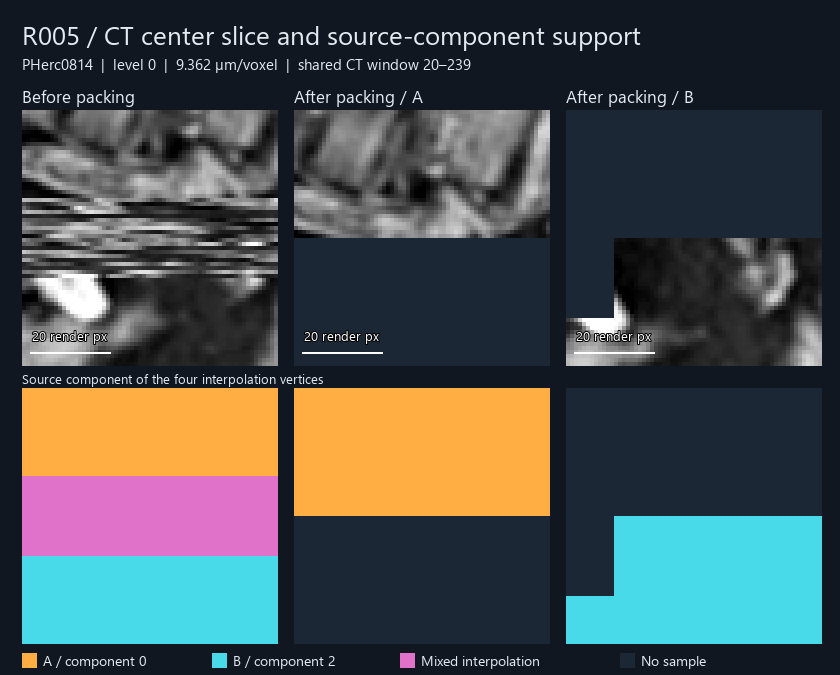

# Vesuvius workflow improvements

Three small improvements to the existing Volume Cartographer / vc_reader surface-rendering workflow, published on 13 November 2026. This repository contains product patches, reproducible checks, measurements, real-CT examples and their limits. It is intended to support one combined November Progress Prizes submission; publication does not mean the entry has been submitted or awarded.

## Follow-up: preserve the original sampling grid

A [follow-up package](2026-11-supplement/README.md) adds the optional `--pack-components-preserve-grid` mode and further evidence for the same three contributions. On two public meshes, the new mode preserves every original sample owner and XYZ bit while exposing 189 and 399 previously hidden samples. A selected real-CT control also preserves all 14,080 samples with single-component support. The package explains the separate low-keep result, remaining within-component conflicts, and limits on readability.

All three contributions were subsequently built together with standard CMake on fixed upstream revision `14d4e725df8b569e6fc8ceb3c04d130f705c1565`. The first-surface XYZ output remained identical, the 18 crop CLI checks passed, and normal, fresh-resume and L0-only-resume Zarr output matched across 15 files and six logical levels. The follow-up includes the patches, fixed input references, measured results and tested build conditions; it is still part of one planned combined submission.

| Improvement | Why it helps | Observed result |
|---|---|---|
| [Keep disconnected surface pieces separate](2026-11/component-packing/README.md) | Prevents unrelated pieces from overlapping or being joined in the flattened output. | Cross-component grid edges fell from 106 and 284 to zero on two public meshes. |
| [Reject incomplete crop requests early](2026-11/crop-guard/README.md) | Catches a missing crop dimension before loading inputs instead of silently selecting the whole surface. | A missing height changed an intended 128 × 128 selection into 13,600 × 3,440 in the original; the patch rejects it early and preserves valid controls. |
| [Recover missing Zarr levels and describe actual output](2026-11/zarr-output-recovery/README.md) | Allows the tested new and partly initialized outputs to resume, and avoids listing nonexistent resolution levels. | Six tested cases matched all 14 normal-control files; mixed-format existing arrays were preserved and missing levels created. |

Start with the linked item README for patches, source revisions and reproduction instructions. The [full technical overview](2026-11/README.md) explains verification and limitations across the bundle. These are patches against the referenced upstream revisions, not a standalone application or a wheel.

## A real-CT example

For one edge selected from geometry before looking at the scan, a small crop originally contained 1,280 pixels interpolated between disconnected pieces. After packing, the tracked faces rendered in separate crops with zero mixed pixels. The crops differ in valid area and raster phase; this is not a pixelwise aligned 3D comparison. The second piece's correspondence to one correct papyrus sheet is unresolved. This work does not establish new text, ink readability or fiber preservation.

## Verification and reuse

The work was prepared using AI agents. An agent other than the implementer independently checked the native product results and the targeted Python entry. Human review, upstream acceptance and external adoption are not claimed. Native checks used an existing Ubuntu 24.04 / GCC 13 setup; a fresh full installation, Python wheel and full test suite were not validated. Item documentation records the narrower tested conditions.

The crop and Zarr changes were also checked together in one renderer. Normal output and first-use resume matched the original 14-file control, and all 18 crop CLI checks passed. Experiments used local CPU computation and no paid cloud computation; local electricity and model usage costs were not calculated.

The [`2026-11/` directory](2026-11/) preserves the reviewed 51-file snapshot byte for byte, including its [SHA-256 manifest](2026-11/MANIFEST.json). References inside that snapshot to a private candidate or unpublished status describe its preparation-time state; this repository is the subsequent public release. Tests and diagnostics support the three product changes rather than being a separate evaluation-tool contribution.

## Licenses and data

Newly authored additions and original explanatory material are offered under MIT according to the per-item notices. Modified Volume Cartographer remains GPLv3; upstream vc_reader/villa and dependencies retain their licenses. Dataset-derived figures and measurements retain their source terms; see [data attribution](2026-11/component-packing/DATA_SOURCES.md). No raw CT, source meshes, third-party build dependencies or compiled executables are included.

